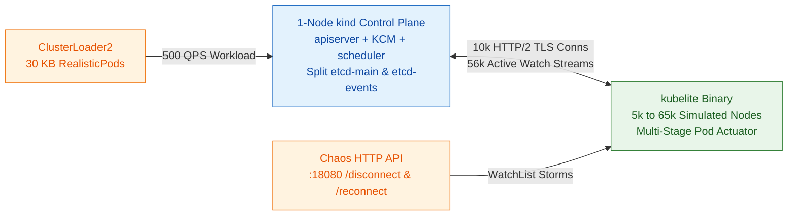

# Kubelite: High-Fidelity Node Simulator for Kubernetes Control-Plane Scalability

## Summary

Testing Kubernetes control-plane changes at 5,000 to 65,000 nodes traditionally forces an ugly tradeoff between cost and fidelity. Real 5,000-node GCE clusters take 64 minutes just to boot 5,000 worker VMs (`10,000` vCPUs, `20 TB` RAM), while existing simulators either require an 84-VM host cluster and drop 70% of kubelet events (`kubemark`) or collapse all 5,000 nodes into a single watch connection with zero per-node fanout (`kwok`).

`kubelite` is a single-binary Go simulator that reproduces the exact HTTP/2 connection count, watch fanout, Lease heartbeat rate, and multi-stage PodStatus write load of 5,000 to 65,000 nodes from a single machine. Paired with a tuned 1-node `kind` control plane, `kubelite` boots a 5,000-node cluster in 4 minutes 40 seconds and matches real 5,000-node CI `kube-apiserver` live heap within 0.5% and cumulative allocations within 7.4%.



---

## Why Kubelite vs KWOK vs Kubemark

`kwok` won broad community adoption for functional controller testing (Karpenter, Kueue, scheduling rules) because it runs as a single zero-dependency binary, but its single-connection controller architecture bypasses the per-node watch fanout and HTTP/2 transport overhead that dominate `kube-apiserver` CPU and memory at scale. `kubelite` keeps `kwok`'s single-binary workflow while faithfully reproducing every per-node connection, watch stream, and status transition.

| Dimension | Real 5k Cluster (`kops`) | Kubemark (5k Hollow Nodes) | KWOK (`kwok-controller`) | Kubelite (5k–65k) |
| :--- | :--- | :--- | :--- | :--- |
| Worker Infrastructure | 5,000 VMs (10k vCPUs, 20 TB RAM) | 84 VMs (672 vCPUs, 2.35 TB RAM) | 1 process (laptop / 1 VM) | 1 process (1 VM) |
| Cluster Bringup Time | 64m 28s | ~45m | <1m | 4m 40s |
| HTTP/2 TLS Connections (5k) | 10,000 (2 per node) | 1 shared `kubeconfig` | 1 controller connection | 10,000 (2 per node, static tokens) |
| Open Watch Streams (5k) | 56,958 | ~55,000 | ~10 (-99.98% fanout) | 56,204 (11/node + volume watches) |
| `PATCH pods/status` per Pod | 9.39 (per-container stages) | ~3 (drops 70% of Events) | 1 (instant stage flip) | 9.37 (init + app container stages) |

---

## Quickstart

```bash
# 1. Boot the tuned 1-node kind control plane (/var/lib/kubelite/kubeconfig)
./up-5k-control-plane.sh

# 2. Build and run kubelite (5,000 nodes with per-node static tokens)
CGO_ENABLED=0 go build -o kubelite .
GOMAXPROCS=48 taskset -c 96-143 ./kubelite \
  --kubeconfig=/var/lib/kubelite/kubeconfig \
  --tokens-file=/var/lib/kubelite/tokens/known_tokens.csv \
  --nodes=5000

# 3. Optional: hot-swap a custom static kube-apiserver binary in <3 seconds
K8S_WORKTREE=/path/to/kubernetes ./hotswap-apiserver.sh

# 4. Trigger a 5,000-node disconnect / WatchList reconnect storm
curl -s -X POST http://127.0.0.1:18080/disconnect
curl -s -X POST "http://127.0.0.1:18080/reconnect?watch_mode=watchlist&node_agents=true"
```

To boot a 65,000-node control plane with 3-way split `etcd` (`main`, `events`, `leases`) and hybrid watch fanout (`2,000` full-watch nodes + `63,000` sparse nodes):

```bash
SCALE=65k ./up-5k-control-plane.sh
./kubelite \
  --kubeconfig=/var/lib/kubelite/kubeconfig \
  --tokens-file=/var/lib/kubelite/tokens/known_tokens.csv \
  --nodes=65000 \
  --full-watch-nodes=2000 \
  --shared-pod-watch=true
```

---

## Fidelity

1:1 comparison running upstream `testing/load/config.yaml` (`CL2_REALISTIC_POD=true`, `60,000+` concurrent 30 KB pods, `1,300` Services) on a 96-vCPU control plane against upstream `ci-kubernetes-e2e-gce-scale-performance-5000` (Prow build `2107878895293304832`):

| Metric | Kubelite (5,000 Nodes) | Real 5,000-Node CI | Delta |
| :--- | :--- | :--- | :--- |
| Cluster Bringup + Validation | 4m 40s | 64m 28s | 13.8x faster |
| `PATCH pods/status` per Pod | 9.37 | 9.39 | -0.2% |
| `GET pods` per Pod | 12.05 | 12.12 | -0.6% |
| Active Watch Streams | 56,204 | 56,958 | -1.3% |
| `kube-apiserver` Live Heap (`inuse_space`) | 9,167 MB | 9,118 MB | +0.5% |
| `kube-apiserver` Cumulative `alloc_space` | 4,006 GB | 3,711 GB | +7.4% |
| `kube-apiserver` P99 CPU | 26.36 cores | 25.91 cores | +1.7% |
| `kube-scheduler` P99 CPU | 10.53 cores | 10.78 cores | -2.3% |
| `etcd-main` P99 CPU | 3.22 cores | 3.25 cores | -0.9% |
| Stateless Pod Startup Latency P99 | 1,212.6s | 1,212.8s | -0.02% |

---

## Studies

Engineering decision records and empirical scale studies are checked in alongside the code under [`studies/`](studies/):

- [2026-10-08: 5,000-Node Fidelity Validation Against Real GCE CI](studies/2026-10-08-5k-fidelity-validation.md)
- [2026-10-08: 10 KB vs 30 KB RealisticPod Scaling at 5,000 and 65,000 Nodes](studies/2026-10-08-30kb-realistic-pod-scaling.md)
- [2026-10-09: 5,000-Node Reconnect WatchList Storm (`k/k#138307`)](studies/2026-10-09-node-reconnect-watchlist-storm.md)
