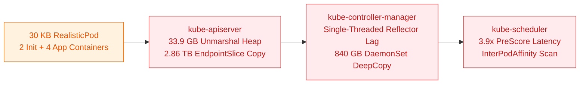

# 10 KB vs 30 KB RealisticPod Scaling at 5,000 and 65,000 Nodes

## Summary

Synthetic scale tests historically used compact 2 KB to 10 KB Pod specs with a single container and no topology constraints. Production clusters run 30 KB Pods with multiple init and sidecar containers, dozens of environment variables, `managedFields`, and pod affinity or topology spread rules.

Running `kubelite` with 30 KB `RealisticPod` templates (`kubernetes/perf-tests#4378`) across 5,000 and 65,000 simulated nodes increases `kube-apiserver` peak RSS 4.23x at 5,000 nodes (23.8 GiB to 100.6 GiB) and reaches 121.5 GiB RSS (7.28 TB cumulative allocations) at 65,000 nodes, exposing three control-plane bottlenecks that compact pod benchmarks completely miss.

| Metric | 5k Nodes (10 KB Pod) | 5k Nodes (30 KB Pod) | 65k Nodes (Compact Pod) | 65k Nodes (30 KB Pod) |
| :--- | :--- | :--- | :--- | :--- |
| Concurrent Pods | 65,013 | 65,013 | 500,000 | 223,000 |
| apiserver Peak RSS | 23.8 GiB | 100.6 GiB | 65.7 GiB | 121.5 GiB |
| apiserver Sampled inuse_space | 5.93 GB | 32.52 GB | 29.22 GB | 56.80 GB |
| apiserver Cumulative alloc_space | 1.71 TB | 3.45 TB | 5.84 TB | 7.28 TB |
| etcd-main In-Use DB Size | 0.61 GiB | 4.78 GiB | 5.32 GB | 14.82 GB |

---

## Bottlenecks Isolated

### 1. Protobuf Unmarshal Retention in Watch Cache (`kube-apiserver`)
- At 5,000 nodes with 30 KB pods, `kube-apiserver` live heap (`inuse_space`) jumps 5.48x from 5.93 GB to 32.52 GB, with 46.6% (15.15 GB) retained by `(*Pod).Unmarshal` (`PodSpec.Unmarshal` 8.88 GB, `Container.Unmarshal` 6.37 GB, `ObjectMeta.Unmarshal` 4.41 GB, and `bytes.Clone` on `FieldsV1.Raw` 2.70 GB).
- At 65,000 nodes with 30 KB pods, `(*PodSpec).Unmarshal` (19.91 GB) and `(*ObjectMeta).Unmarshal` (14.01 GB) account for 59.7% of the 56.80 GB sampled heap.

### 2. Cacher `EndpointSlice.DeepCopyInto` on Initial Watch Streams (`k/k#141347`)
- At 65,000 nodes, `discovery.(*EndpointSlice).DeepCopyInto` consumes 2.86 TB (47.9% of `kube-apiserver` cumulative allocations in Tier 2) and 1.08 TB (14.9% in Tier 3) inside `cacher.(*cacheWatcher).processInterval` when streaming initial `EndpointSlices` to 2,000 `kube-proxy` watchers.
- Upstream fix [`k/k#141347`](https://github.com/kubernetes/kubernetes/pull/141347) replaces the full deep copy in `cacher.getMutableObject` with a shallow wrapper copy.

### 3. KCM DaemonSet 5x `PodSpec.DeepCopy` (`k/k#140167`) and Single-Threaded Reflector Lag
- In `kube-controller-manager` predating [`k/k#140167`](https://github.com/kubernetes/kubernetes/pull/140167), `NodeShouldRunDaemonPod` constructed a pod and called `AddOrUpdateTolerationInPodSpec` (5x `podSpec.DeepCopy()`) per node on every sync, allocating 839.5 GB (34.8% of KCM allocations) on 30 KB pods.
- Under 500 QPS of 30 KB Pod mutations (15 MB/s per watcher), KCM's single-threaded Pod informer `Reflector` processes only 45 to 80 events/s, causing `ConsistencyStore` (`ConsistentReadsFromCache`) to stall StatefulSet and ReplicaSet syncs waiting for the informer read version to catch up.

---

## Decision

Default `cl2-5k-overrides.yaml` to `CL2_REALISTIC_POD: true` so all control-plane benchmarks run against 30 KB multi-container pods, and use `trimPodForSimulator` inside `kubelite` to keep simulator RSS under 11 GiB at 65,000 nodes.
