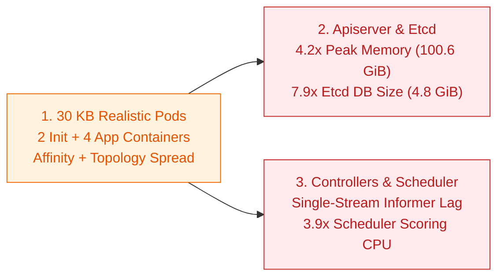

# 10 KB vs 30 KB Realistic Pod Scaling ([perf-tests#4378](https://github.com/kubernetes/perf-tests/pull/4378))

## Summary

Synthetic scale tests historically used compact 2 KB to 10 KB pod specs with a single container and no placement rules. Production clusters run 30 KB pods with multiple init and sidecar containers, dozens of environment variables, server-side apply field tracking, and pod affinity or topology spread constraints.

- **Apiserver memory jumps 4.2x at 5,000 nodes (23.8 GiB to 100.6 GiB RSS):** Unmarshaling 30 KB pods across 65,000 concurrent pods retains 32.5 GB of live heap at 5,000 nodes and 56.8 GB at 65,000 nodes.
- **Controller-manager informer lag stalls workload controllers at 500 QPS:** A single-threaded pod watch reflector can only decode 45 to 80 large pod events per second, causing controller read-version checks to stall waiting for the watch stream to catch up.
- **Scheduler scoring latency increases 3.9x (7.3ms to 21.4ms P99):** Evaluating inter-pod affinity and topology spread rules across 30 KB pods consumes 85% of scheduler CPU during scale-up.

| Metric (65,000 Concurrent Pods) | 5k Nodes (10 KB Pod) | 5k Nodes (30 KB Pod) | 65k Nodes (30 KB Pod) |
| :--- | :--- | :--- | :--- |
| Apiserver Peak Memory (RSS) | 23.8 GiB | 100.6 GiB (4.2x) | 121.5 GiB |
| Apiserver Live Heap | 5.93 GB | 32.52 GB (5.5x) | 56.80 GB |
| Apiserver Cumulative Allocations | 1.71 TB | 3.45 TB (2.0x) | 7.28 TB |
| Etcd In-Use Database Size | 0.61 GiB | 4.78 GiB (7.9x) | 14.82 GB |
| Scheduler Scoring Latency (P99) | 7.32ms | 21.44ms (2.9x) | 31.60ms |

---

## Bottlenecks

1. **Pod unmarshaling dominates live apiserver heap ([pod.pb.go](https://github.com/kubernetes/kubernetes/blob/master/staging/src/k8s.io/api/core/v1/generated.pb.go)):** At 5,000 nodes with 30 KB pods, apiserver live heap increases 5.5x (5.93 GB to 32.52 GB), with 46.6% (15.15 GB) held in decoded pod specs, container lists, object metadata, and cloned field-tracking bytes. At 65,000 nodes, decoded pod specs (19.91 GB) and metadata (14.01 GB) account for 59.7% of the 56.80 GB sampled heap.
2. **Initial watch delivery deep-copies every EndpointSlice ([watch_cache_interval.go](https://github.com/kubernetes/kubernetes/blob/master/staging/src/k8s.io/apiserver/pkg/storage/cacher/watch_cache_interval.go), [k/k#141347](https://github.com/kubernetes/kubernetes/pull/141347)):** Streaming initial EndpointSlices to 2,000 node-proxy watchers allocates 1.08 TB to 2.86 TB in deep copies before [k/k#141347](https://github.com/kubernetes/kubernetes/pull/141347) replaces the full object copy with a shallow wrapper copy.
3. **DaemonSet syncs copy 30 KB pod templates 5x per node ([daemon_controller.go](https://github.com/kubernetes/kubernetes/blob/master/pkg/controller/daemon/daemon_controller.go), [k/k#140167](https://github.com/kubernetes/kubernetes/pull/140167)):** Before [k/k#140167](https://github.com/kubernetes/kubernetes/pull/140167) hoisted pod template construction out of the per-node loop, adding the 5 default DaemonSet tolerations deep-copied the entire 30 KB pod spec 5 times per node on every sync (839.5 GB, or 34.8% of controller-manager allocations).
4. **Single-threaded informer decoding lags under 500 QPS pod churn ([reflector.go](https://github.com/kubernetes/kubernetes/blob/master/staging/src/k8s.io/client-go/tools/cache/reflector.go)):** Mutating 30 KB pods at 500 QPS streams 15 MB/s to every pod watcher. Because controller-manager's single-threaded pod reflector decodes only 45 to 80 large pods per second, its local cache version falls behind etcd and blocks StatefulSet and ReplicaSet reconciles.
