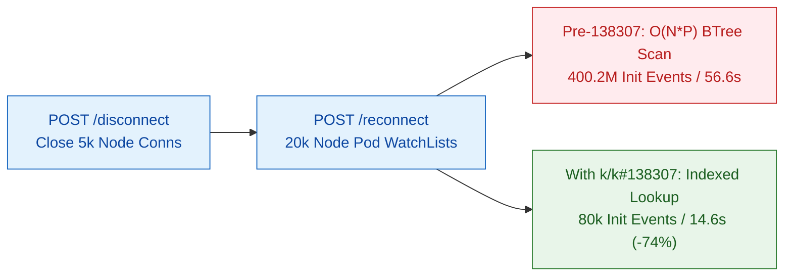

# 5,000-Node Reconnect WatchList Storm (`k/k#138307`)

## Summary

When thousands of nodes reconnect after a network partition or control-plane restart, each kubelet and node agent opens a `WatchList` (`sendInitialEvents=true&resourceVersionMatch=NotOlderThan`) scoped to `fieldSelector=spec.nodeName=<node>`. Before [`k/k#138307`](https://github.com/kubernetes/kubernetes/pull/138307), `cacher.(*cacheWatcher).processInterval` ignored the `spec.nodeName` index during initial `WatchList` streaming and scanned every Pod in the cluster (`O(N * P)`), turning a 5,000-node reconnect into a 400-million-event CPU and memory storm.

Using `kubelite`'s HTTP chaos API (`/disconnect` followed by `/reconnect` across 5,000 nodes and 20,000 DaemonSet pods) proves that `k/k#138307` cuts reconnect duration 3.88x (56.62s to 14.58s), reduces `apiserver_init_events_total{resource="pods"}` 5,002x (400.2M to 80k), and drops `processInterval` heap allocations 94.5x (123.3 GB to 1.3 GB).



| Metric (5,000 Nodes, 20,000 Pods) | Pre-`k/k#138307` (`6b56dd11c96~1`) | With `k/k#138307` (`HEAD`) | Improvement |
| :--- | :--- | :--- | :--- |
| Reconnect Time to 80k Active Watches | 56.62s | 14.58s | 3.88x faster (-74.3%) |
| `apiserver_init_events_total{resource="pods"}` | 400,200,000 | 80,000 | 5,002.5x (-99.98%) |
| apiserver 30s Reconnect CPU | 1,198.8s (40.0 cores) | 514.5s (17.2 cores) | 2.33x (-57.1%) |
| `(*cacheWatcher).processInterval` CPU | 600.5s (50.1% of total) | 12.0s (2.3% of total) | 50.0x (-98.0%) |
| `(*cacheWatcher).processInterval` Allocs | 123,330 MB (59.8%) | 1,305 MB (1.5%) | 94.5x (-98.9%) |

---

## Repro Setup

1. Boot the 1-node `kind` control plane and start `kubelite` with 5,000 full-watch nodes and node-agent `WatchList` streams enabled (`4` Pod `WatchList`s per node = `20,000` `spec.nodeName` Pod `WatchList` streams, plus `65,000` other node/service/endpointslice watches):
   ```bash
   ./kubelite --nodes=5000 --watch-mode=watchlist --simulate-node-agents=true
   ```
2. Schedule 4 DaemonSets (`20,000` running Pods across the 5,000 nodes).
3. Trigger mass node disconnect and simultaneous reconnect via the chaos endpoint:
   ```bash
   curl -s -X POST "http://127.0.0.1:18080/disconnect"
   curl -s -X POST "http://127.0.0.1:18080/reconnect?watch_mode=watchlist&node_agents=true&stagger=500ms"
   ```

---

## Profile Breakdown

| `kube-apiserver` Function | Pre-`k/k#138307` Reconnect | With `k/k#138307` Reconnect | Delta |
| :--- | :--- | :--- | :--- |
| `(*cacheWatcher).processInterval` (CPU) | 600.53s (50.10%) | 12.00s (2.33%) | -98.0% |
| `(*btreeStore).rangePrefix.func1` (CPU) | 580.70s (48.44%) | 0.44s (0.09%) | -99.92% |
| `storeElementToWatchCacheEvent` (CPU) | 496.44s (41.41%) | 0.05s (0.01%) | -99.99% |
| `runtime.mallocgc` (CPU) | 673.02s (56.14%) | 104.05s (20.22%) | -84.5% |
| Total Reconnect `alloc_space` Delta | 206,176 MB | 85,371 MB | -58.6% (-118 GiB) |
| Peak `kube-apiserver` RSS | 24.64 GiB | 16.77 GiB | -32.0% (-7.9 GiB) |

---

## Decision

Keep `--watch-mode=watchlist` and `--control-addr=127.0.0.1:18080` (`/disconnect`, `/reconnect`, `/status`) enabled by default in `kubelite`, and retain `synced=false` when a `WatchList` stream aborts before 60s so aborted streams faithfully retry `WatchList`.
