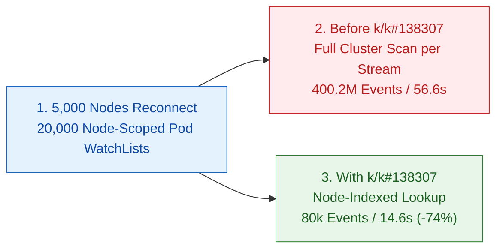

# 5,000-Node Reconnect WatchList Storm ([k/k#138307](https://github.com/kubernetes/kubernetes/pull/138307))

## Summary

When thousands of nodes reconnect after a network partition or control-plane restart, each kubelet and node agent opens an initial watch list stream for the pods scheduled on its node. Before [k/k#138307](https://github.com/kubernetes/kubernetes/pull/138307), the watch cache ignored the node-name index during initial watch list delivery and scanned all 20,000 pods in the cluster for every reconnecting stream, turning a 5,000-node reconnect into a 400-million-event CPU and memory storm.

- **Reconnect time drops 3.9x (56.6s to 14.6s):** Routing initial watch list delivery through the node-name index looks up only the 4 pods on each node instead of scanning all 20,000 cluster pods.
- **Scanned pod events drop 5,000x (400.2M to 80k):** Initial watch catch-up CPU falls from 50.1% of total apiserver CPU (600.5s) to 2.3% (12.0s).
- **Watch catch-up allocations drop 95x (123.3 GB to 1.3 GB):** Total apiserver reconnect allocations drop by 118 GiB (-58.6%) and peak memory drops from 24.6 GiB to 16.8 GiB (-32.0%).



| Metric (5,000 Nodes, 20,000 Pods) | Before ([6b56dd11c96~1](https://github.com/kubernetes/kubernetes/commit/6b56dd11c96~1)) | With [k/k#138307](https://github.com/kubernetes/kubernetes/pull/138307) |
| :--- | :--- | :--- |
| Reconnect Time to 80k Active Watches | 56.62s | 14.58s (-74.3%) |
| Initial Pod Watch Events Scanned | 400,200,000 | 80,000 (-99.98%) |
| Apiserver Reconnect CPU (30s Window) | 40.0 cores (1,198.8s) | 17.2 cores (514.5s, -57.1%) |
| Initial Watch Catch-Up CPU | 600.5s (50.1% of total) | 12.0s (2.3% of total, -98.0%) |
| Initial Watch Catch-Up Allocations | 123.3 GB (59.8% of total) | 1.3 GB (1.5% of total, -98.9%) |
| Peak Apiserver Memory (RSS) | 24.64 GiB | 16.77 GiB (-32.0%) |

---

## Root Cause

During a mass reconnect across 5,000 nodes (each running kubelet plus 3 node-local agents), the apiserver receives 20,000 concurrent initial watch list requests filtered to a single node's pods:

1. **Full B-tree scan on every node watch ([watch_cache.go](https://github.com/kubernetes/kubernetes/blob/6b56dd11c96/staging/src/k8s.io/apiserver/pkg/storage/cacher/watch_cache.go)):** When building the initial watch interval from the in-memory snapshot, the watch cache previously ignored the indexed node-name trigger and walked the entire B-tree snapshot (48.4% of total apiserver CPU).
2. **Per-pod event conversion before filtering ([watch_cache_interval.go](https://github.com/kubernetes/kubernetes/blob/6b56dd11c96/staging/src/k8s.io/apiserver/pkg/storage/cacher/watch_cache_interval.go)):** Every scanned pod was wrapped into a temporary watch event before checking whether its node name matched the watcher (41.4% of CPU and 123.3 GB of transient heap allocations), driving garbage collection to 56.1% of total apiserver CPU.
3. **Indexed snapshot lookup ([k/k#138307](https://github.com/kubernetes/kubernetes/pull/138307)):** Querying the watch cache snapshot by the node-name index returns only the 4 pods scheduled on that node, eliminating both the full B-tree traversal (580.7s down to 0.44s) and temporary event allocations (496.4s down to 0.05s).

---

## Setup

```bash
# 1. Start 5,000 simulated nodes with WatchList and node-agent watches enabled
./kubelite --nodes=5000 --watch-mode=watchlist --simulate-node-agents=true

# 2. Schedule 4 DaemonSets (20,000 running pods across 5,000 nodes)

# 3. Trigger mass disconnect and simultaneous WatchList reconnect storm
./kubelite disconnect
./kubelite reconnect --watch-mode=watchlist --node-agents=true --stagger=500ms
```
